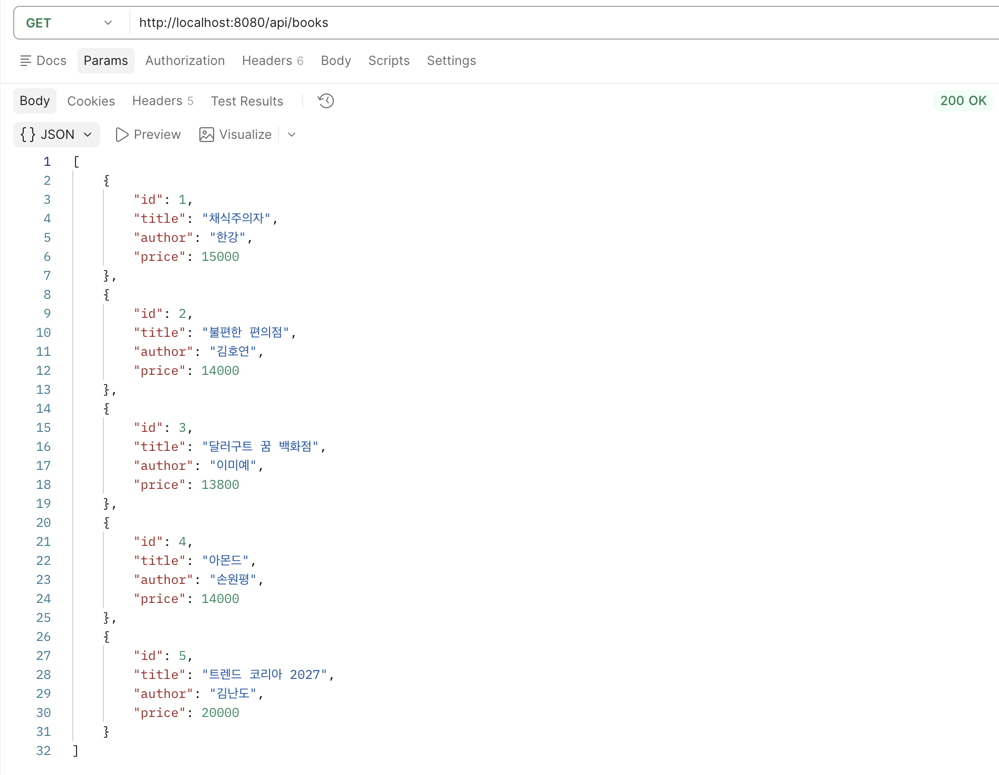
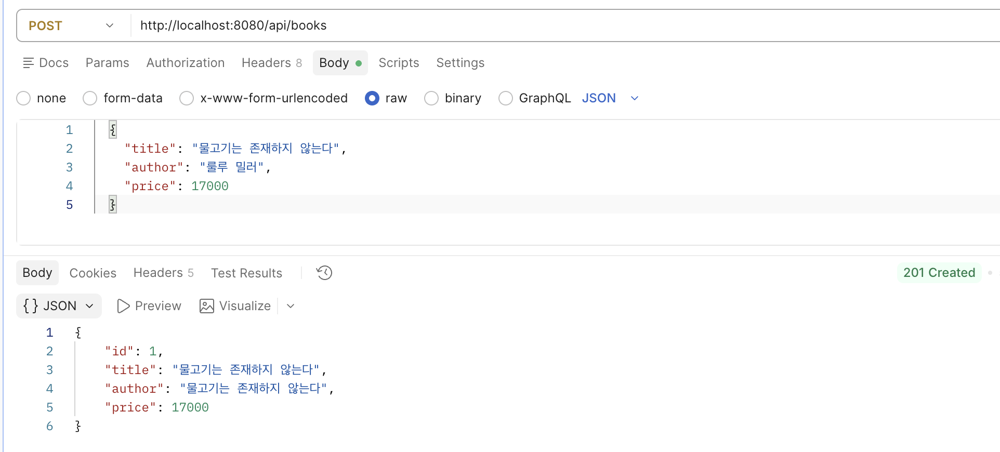
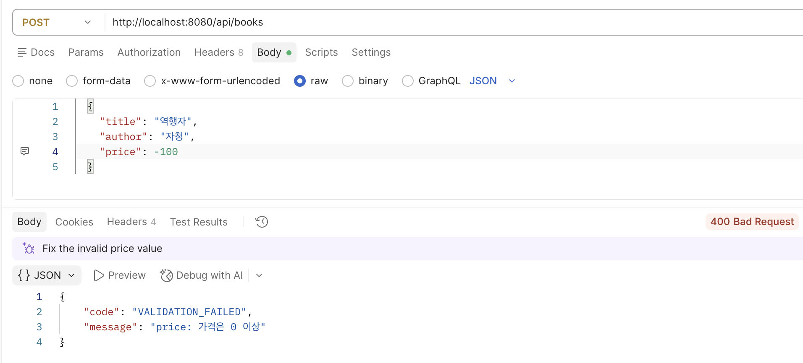
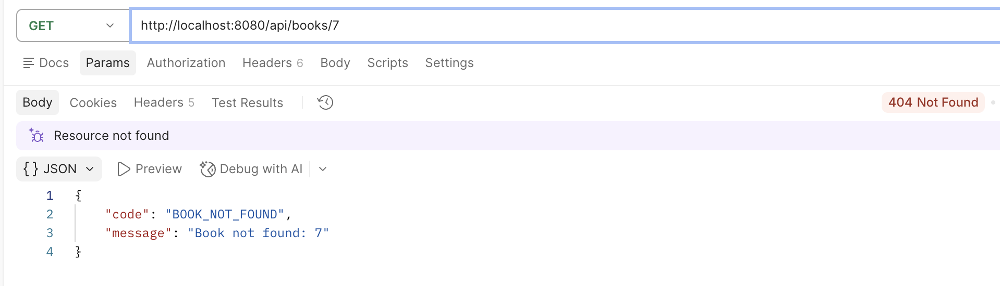
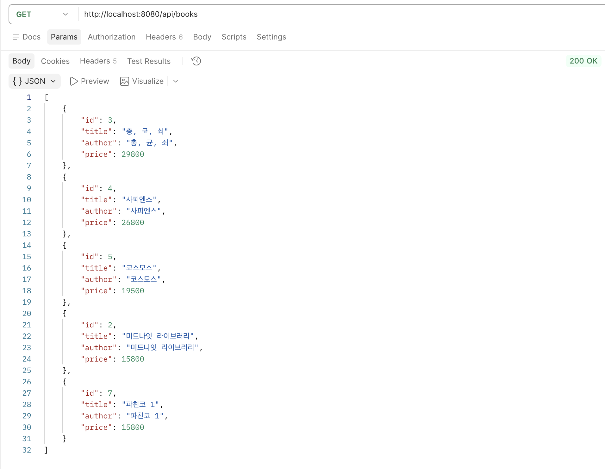
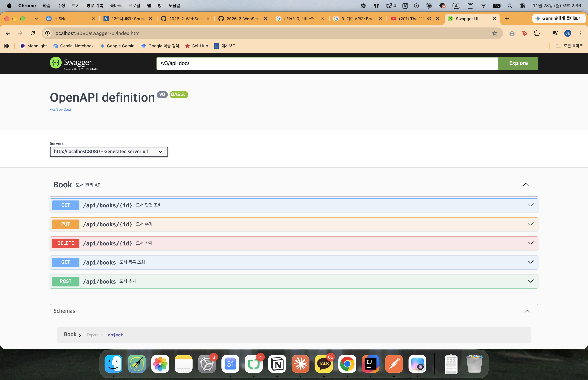
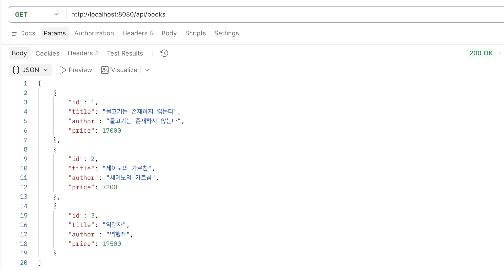
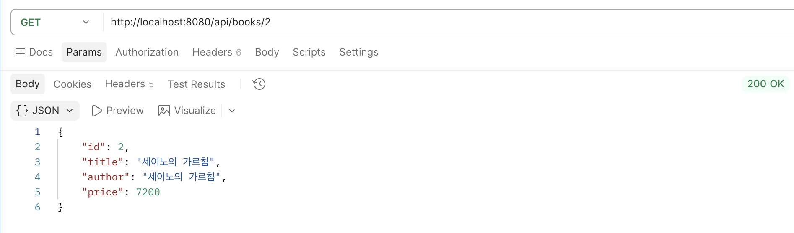
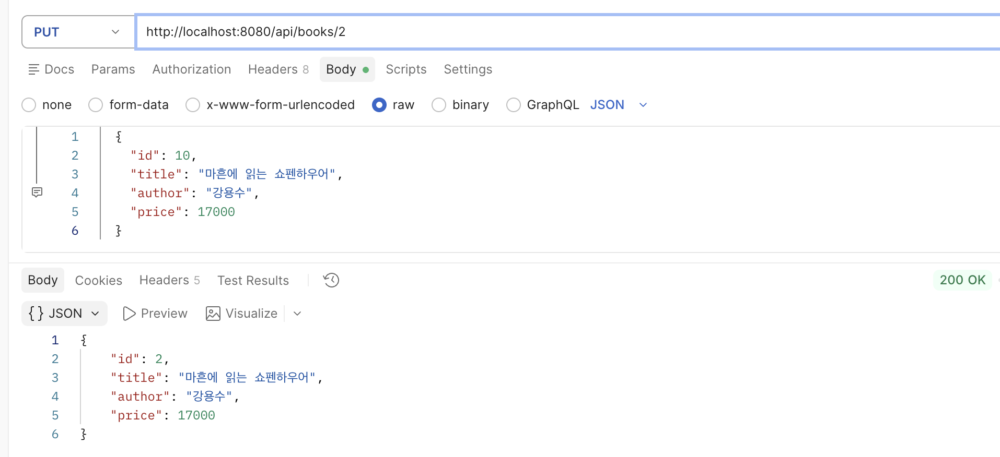
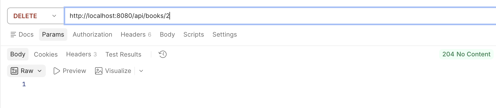

# Week 12 Spring Boot REST API Advanced Customizing & Deployment

## Project Information: 프로젝트 소개, GitHub URL, Render URL
| 구분 | 링크                                                         |
| :--- |:-----------------------------------------------------------|
| **Render 배포 URL** | https://assign11-c01-22200488.onrender.com                 |
| GitHub (Organization) | https://github.com/2026-2-WebService/assign11-c01-22200488 |
| GitHub (Personal) | https://github.com/dbseend/assign11-c01-22200488           |

## Installation: Java/DB 환경과 실행 방법
- Java 17 필요
- Gradle 8.x 설치 후 `gradle bootRun` (프로젝트에는 공식 Gradle Wrapper 바이너리가 포함되지 않았습니다.)
- 기본값은 학습 편의상 메모리 H2 DB입니다. 재시작 시 데이터가 초기화됩니다.
- MariaDB 실습: `docker compose up -d` 후 아래 환경 변수를 설정하여 실행하세요.
  - `SPRING_PROFILES_ACTIVE=mariadb`
  - `DB_URL=jdbc:mariadb://localhost:3307/week12`
  - `DB_USERNAME=week12`, `DB_PASSWORD=week12_local_only`
  - 처음 DB 생성 시에만 `DDL_AUTO=update` (이후 `validate` 권장)
- **Render 배포**에서는 DB_URL/DB_USERNAME/DB_PASSWORD와 `SPRING_PROFILES_ACTIVE=mariadb`, `DDL_AUTO=validate`를 설정하고, 외부 MariaDB 접근을 사전에 확인하세요.

## Source Code Exploration: 분석 질문 8개 답변, 주석 작성한 메서드 3개
### Project Structure & JPA
1. BookController, BookService, BookRepository의 역할과 요청 처리 흐름을 설명하세요.
  - PostController는 파일 관련 CRUD 요청을 처리하는 컨트롤러로, 파일 업로드·수정·삭제와 업로드된 파일의 목록 조회·상세 조회를 담당한다.
  - PostService는 컨트롤러가 요청한 기능을 실제로 수행하는 비즈니스 로직을 담당한다.
  - PostRepository는 서비스의 비즈니스 로직을 거친 뒤, 데이터베이스에 파일 관련 데이터를 저장하고 조회하는 역할을 담당한다.
  - Controller → Service → Repository로 이어지는 계층별 역할 분리를 통해 계층 간 결합도를 낮추고 모듈화를 달성한다.
2. JpaRepository<Book, Long>만 선언해도 findAll(), save()를 사용할 수 있는 이유를 설명하세요.
  - JpaRepository를 상속 받을 시 save(), findAll()와 같은 기본 메소드는 프로그램 실행 시 런타임 환경에서 자동으로 구현되기 때문에 구현없이 선언만으로 사용할 수 있다.

### DTO & HTTP Response
3. 기존 API가 Book Entity를 직접 요청·응답에 사용할 때 발생할 수 있는 문제를 설명하세요. 
  - Entity를 직접 사용하는 경우 보안(ID 등 서버 관리 필드의 노출·변경 위험), 결합도(Entity 변경이 API 구조에 영향), 데이터 노출(불필요한 필드까지 노출), 직렬화(연관관계로 인한 순환 참조) 문제가 발생할 수 있다.
4. Request DTO와 Response DTO를 분리하는 이유와 ResponseEntity가 필요한 상황을 설명하세요.
   - Request DTO(클라이언트->서버 데이터)와 Response DTO(서버->클라이언트 데이터)는 서로 필요한 필드가 달라서 분리한다.
   - ResponseEntity는 200 외에 201,204,404처럼 다양한 상태 코드,헤더,본문을 직접 제어해야 할 때 사용한다 .

### Validation & Exception Handling
5. @Valid, @NotBlank, @Min은 각각 어느 시점에 어떤 동작을 수행하나요?
    - @Valid는 컨트롤러에서 @RequestBody가 JSON을 Request DTO로 변환한 직후, 메서드 실행 전에 DTO의 검증 규칙을 검사한다(통과하면 메서드 실행, 실패하면 예외 발생). 
    - @NotBlank(null, 빈 문자열, 공백 문자열 불허)와 @Min(숫자의 최솟값 제한)은 DTO 필드에 선언하는 규칙이다.
    - DTO에서 선언한 규칙들에 대해서 검사할 때 실제로 @Valid를 통해서 적용된다.
6. @RestControllerAdvice와 @ExceptionHandler를 사용하면 예외 처리 흐름이 어떻게 바뀌나요?
   - 기존 방식은 Service에서 던진 예외(예: ProductNotFoundException)를 컨트롤러마다 따로 처리한다.
   - @RestControllerAdvice 클래스의 @ExceptionHandler 메서드가 예외 유형별로 받아 ResponseEntity로 적절한 상태 코드(404 등)와 일관된 ApiError 응답을 반환한다.

### Pagination & OpenAPI
7. Pageable과 Page<T>는 각각 어떤 역할을 하며 sort=price,desc는 어떻게 처리되나요?
  - Pageable은 페이지 번호, 페이지 크기, 정렬 정보를 전달하는 인터페이스이고, Page<T>는 조회된 데이터와 전체 페이지 수 등 페이징 정보를 함께 담아 돌려주는 결과 객체이다. 
  - sort=price,desc는 Pageable의 정렬 정보로 전달되어 가격 기준 내림차순으로 정렬하겠다는 것을 명시한 것이다.
8. /v3/api-docs와 /swagger-ui.html의 역할을 구분해서 설명하세요.
   - /v3/api-docs는 API의 URL, HTTP Method, 요청/응답 구조를 기술한 OpenAPI JSON 명세를 반환하는 주소이다.
   - /swagger-ui.html은 그 명세를 웹 화면에 표시하며 브라우저에서 API를 직접 테스트하는 Swagger UI 접속 주소이다.

## Refactoring: DTO와 ResponseEntity 변경 전/후
### DTO
- 기존: 필드에 대해서 유효성 검사 없음
```
public record BookRequest(  
    String title,
    String author,
    int price
) {
}
```
- 신규: @NotBlank, @Min을 통해서 필드의 유효성(공백 허용X, 최소값 지정) 검사 추가
```
public record BookRequest(
    @NotBlank(message = "도서명 필수")
    String title,
    @NotBlank(message = "저자명 필수")
    String author,
    @Min(value = 0, message = "가격은 0 이상")
    int price
) {
}
```
### ResponseEntity
- 기존: 반환 타입이 DTO(Entity)여서 상태 코드를 지정할 수 없고, 성공하면 항상 200 OK로 응답됨
```
@PostMapping
public Book create(@RequestBody Book input) {
    return service.create(input);
}

@DeleteMapping("/{id}")
public void delete(@PathVariable Long id) {
    service.delete(id);
}
```
- 신규: ResponseEntity를 통해서 상태 코드(POST 201 Created, DELETE 204 No Content)를 직접 지정하여 HTTP 의미에 맞는 응답 반환
```
@PostMapping
public ResponseEntity<BookResponse> create(@Valid @RequestBody BookRequest bookRequest) {
    return ResponseEntity
            .status(HttpStatus.CREATED)
            .body(service.create(bookRequest));
}

@DeleteMapping("/{id}")
public ResponseEntity<Void> delete(@PathVariable Long id) {
    service.delete(id);
    return ResponseEntity.noContent().build();
}
```

## New Features: Validation, 공통 예외 처리, Pagination/Sorting, Swagger
### Validation
- BookRequest의 title, author가 공백이면 거부, price가 음수이면 거부
- Controller에서 @Valid @RequestBody로 검증하고, 실패 시 MethodArgumentNotValidException이 발생하여 400 Bad Request 반환

### 공통 예외 처리
- GlobalExceptionHandler(@RestControllerAdvice)에서 예외 유형별로 @ExceptionHandler가 처리하고 ApiError(code, message) JSON 반환

| 예외 | 상태 코드 | code |
|---|---|---|
| MethodArgumentNotValidException | 400 | VALIDATION_FAILED |
| HttpMessageNotReadableException (유효하지 않은 JSON) | 400 | INVALID_JSON |
| BookNotFoundException (없는 ID 조회·수정·삭제) | 404 | BOOK_NOT_FOUND |

- 응답 예시
```
{
  "code": "BOOK_NOT_FOUND",
  "message": "Book not found: 7"
}
```
### Pagination/Sorting
- GET /api/books?page=0&size=5&sort=price,desc 형태로 페이지 번호, 크기, 정렬 지정
- Controller에서 Pageable을 받고, @PageableDefault로 기본값(size=5, price 내림차순) 설정
- Service에서 repository.findAll(pageable)로 해당 페이지의 데이터만 조회

### Swagger
- 의존성: springdoc-openapi-starter-webmvc-ui:2.8.9
- Swagger UI: http://localhost:8080/swagger-ui.html, OpenAPI JSON 명세: `http://localhost:8080/v3/api-docs`
- @Tag(도서 관리 API)와 @Operation(도서 추가·목록 조회·단건 조회·수정·삭제)으로 API 설명 추가

## Testing & Deployment: results/ 스크린샷 6장 이상 및 배포 URL

- 배포 URL: https://assign11-c01-22200488.onrender.com

### 1. 초기 Sample CRUD 테스트


### 2. DTO 적용 후 POST 성공 (201)


### 3. 잘못된 입력 요청 (400)


### 4. 존재하지 않는 ID (404)


### 5. 페이지/정렬 적용 결과


### 6. Swagger UI / API 테스트 화면


### 7. 기존 CRUD 정상 동작 확인
- GET 목록 조회 (200)

- GET 단건 조회 (200)

- PUT 수정 (200)

- DELETE 삭제 (204)


## Weekly Review: 새롭게 배운 내용 3가지, 어려웠던 점과 해결 방법, AI 활용 내용 및 느낀 점
### 새롭게 배운 내용 3가지
1. @Valid를 통해 필드의 유효성 검사를 일일이 직접하지 않고 어노테이션을 사용해서 효과적으로 관리할 수 있음.
2. ExceptionHandler를 통해서 각 예외마다 따로 처리하는 것이 아니라 한번에 모아서 처리할 수 있음.
3. Swagger와 같은 API 문서 제작을 통해 다른 사람과 협업 할 때 유용하게 사용할 수 있음.

### 어려웠던 점과 해결 방법
- 

### AI 활용 내용 및 느낀 점
